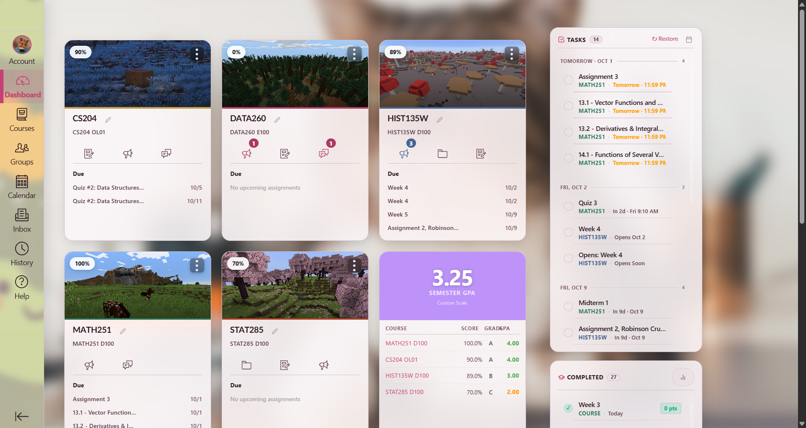
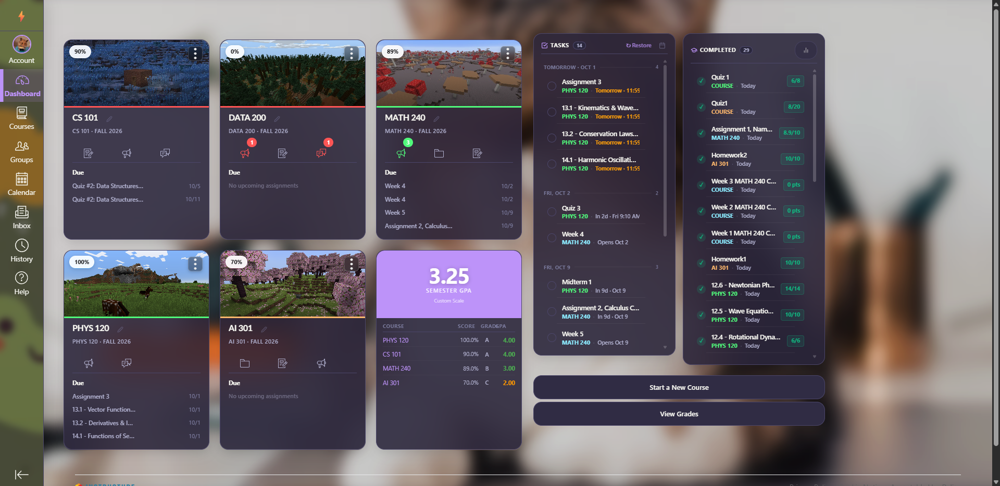
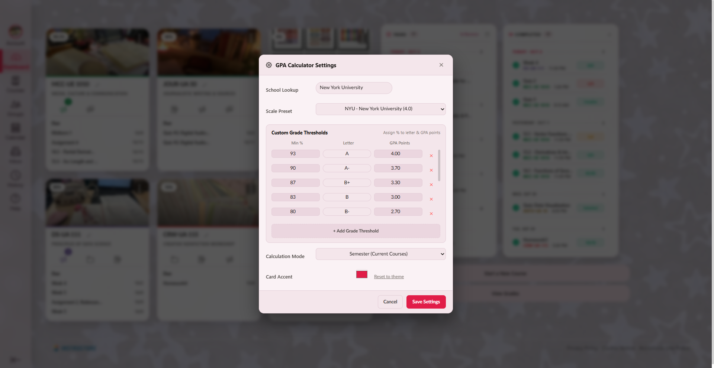
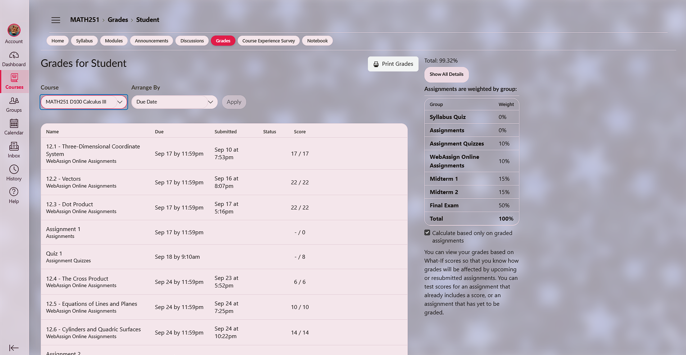
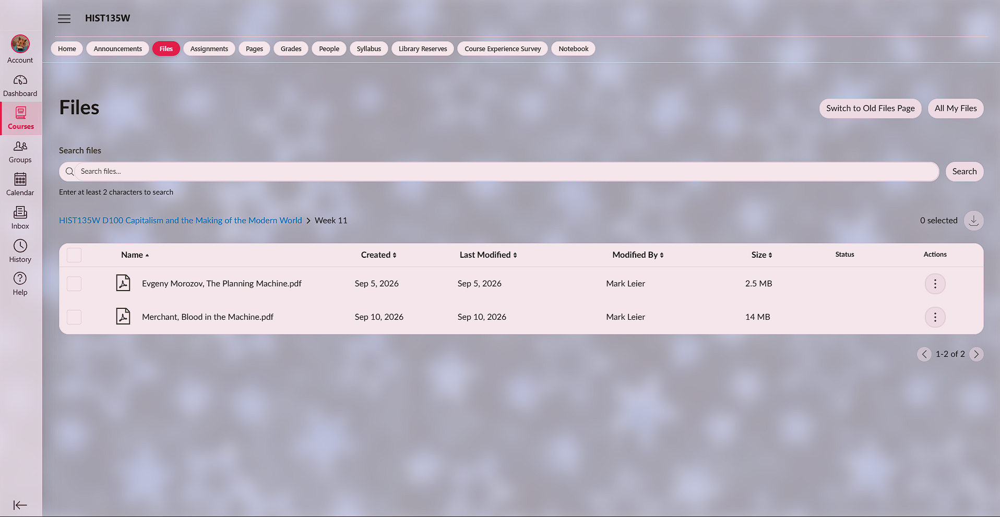

<div align="center">

# CanvasCustomizer

**A lightweight, tactile dark mode and aesthetic theme engine for Canvas LMS.**  
*Free, local-first, zero telemetry, and 100% open-source.*

[](https://github.com/EISHANnyc/CanvasCustomizer/releases)
[](LICENSE)
[](manifest.json)
[](https://github.com/EISHANnyc/CanvasCustomizer/actions)

<br/>

<a href="#overview">
  
</a>

<p align="center">
  <a href="https://github.com/EISHANnyc/CanvasCustomizer/archive/refs/heads/main.zip"><b>Download ZIP</b></a> •
  <a href="#installation"><b>Installation</b></a> •
  <a href="#features"><b>Features</b></a> •
  <a href="#themes"><b>Themes</b></a>
</p>

</div>

---

## Overview

Canvas LMS default interfaces use pure white (`#ffffff`) layouts that cause eye strain during extended night study sessions. Paid extensions charge recurring subscriptions for basic customization.

**CanvasCustomizer** provides a free, local-first Chrome extension that overhauls Canvas into a high-contrast workspace with curated palettes, custom wallpapers, a multi-university GPA engine, and tactile controls.

---

## Features

- **16 Curated Presets**: 8 nocturnal themes (Dracula, Midnight Plum, Slate, Matcha Latte, Crimson) and 8 daylight paper palettes (Linen Day, Rose Milk, Sunlit Cream, Porcelain).
- **Custom Wallpapers & Blur**: Apply image backgrounds with real-time blur, opacity, and card radius sliders.
- **Built-in GPA Calculator**: Live grade calculations supporting university grading scales (NYU, UBC, UofT, SFU, standard 4.0, and percentage-based weighting).
- **Smart Content Contrast**: Prevents invisible text or clash highlights pasted from external editors. The contrast engine normalizes instructor text colors and converts highlights into legible translucent pills.
- **Zero Bloat & Zero Telemetry**: Under 700 KB unpacked. Operates locally in-browser with no analytics, user tracking, or background network calls.

---

## Installation

### Option A: Clone

```bash
git clone https://github.com/EISHANnyc/CanvasCustomizer.git
```

### Option B: Manual Setup

1. **Download**: Click [**Download ZIP**](https://github.com/EISHANnyc/CanvasCustomizer/archive/refs/heads/main.zip) and extract the archive.
2. **Open Extensions**: Navigate to `chrome://extensions` in Chrome, Brave, or Edge.
3. **Developer Mode**: Enable **Developer mode** in the top-right corner.
4. **Load Unpacked**: Click **Load unpacked** and select the extracted `CanvasCustomizer` folder.
5. **Open Canvas**: Refresh Canvas and pick a theme from the extension popup.

---

## Themes Showcase

| Theme | Type | Style |
| :--- | :---: | :--- |
| **Dracula Night** | Dark | Midnight slate, twilight cards, violet accents |
| **Matcha Latte** | Dark | Dark green tea background, sage text, mint pills |
| **Midnight Plum** | Dark | Twilight indigo, plum cards, magenta accents |
| **Linen Day** | Light | Tactile beige paper, espresso typography |
| **Rose Milk** | Light | Strawberry cream, subtle rose borders, ruby ink |
| **Sunlit Cream** | Light | Warm parchment, amber accents, charcoal text |

---

## Screenshots

<details>
<summary><b>Click to expand full screenshots gallery</b></summary>
<br/>

### Modernized Dashboard with Custom Cards


### Live Multi-Scale GPA Calculator


### High-Contrast Grades & Scores


### Clean Reading Layout


</details>

---

## Privacy & Local-First Guarantee

CanvasCustomizer does not collect, transmit, or store user data remotely. All custom themes, GPA values, course nicknames, and background images persist strictly within your browser local storage.

---

## License

Distributed under the [MIT License](LICENSE).
